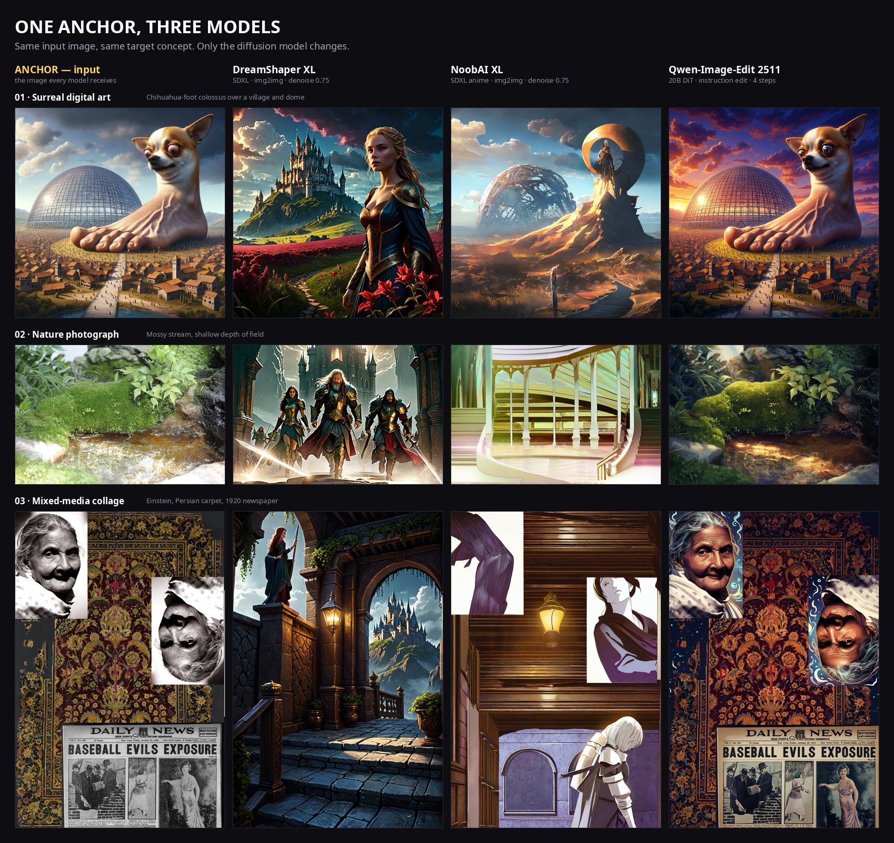
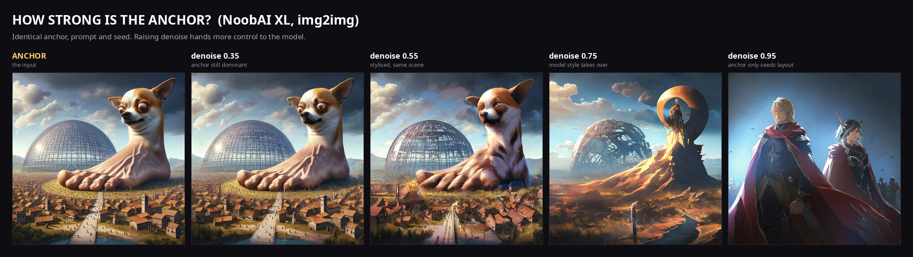
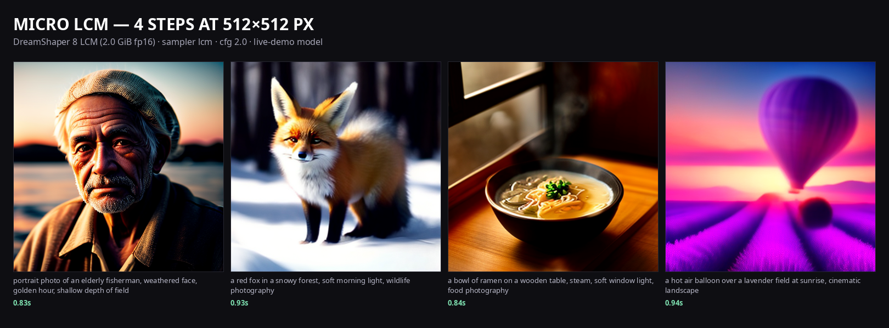

# Anchor × Model — a ComfyUI image-to-image demonstration

Three very different input images, three diffusion models, one target concept. The
point is to show that an **anchor has no fixed effect**: what a model does with it
depends on the model's prior, and on how much denoise you give it.





Open **[`gallery.html`](gallery.html)** for the interactive version — hold the button
(or the space bar) to reveal the anchor under every result. Every card has a **PNG**
download link, and **Download all images** saves `outputs/gallery-images.zip` (the
anchors, all matrix and ladder results, and both contact sheets). `gallery.html` is
generated by `run_all.sh`; the screenshots above are kept in `docs/screenshots/` so the
README renders on a fresh clone.

## Recorded demo (fallback)

**[▶ `docs/demo/anchor-model-demo.mp4`](docs/demo/anchor-model-demo.mp4)** — 1:46,
1920×1080, silent with burned-in captions. It is the fallback recording for a live
demo: the real ComfyUI UI running workflow 04 on the 2 GB micro model, then the 3 × 3
matrix, the denoise ladder, the generated gallery and the Windows launch steps.
Chapter list and a narration script are in [`docs/demo/README.md`](docs/demo/README.md).

## Quick start

The three base images are committed in `images/`. Model weights are not — the
**2 GB micro diffusion model** downloads on demand into `models/`. The SDXL and
Qwen models used by the full comparison are optional: if you already have them
locally, symlink them in as described in [`models/README.md`](models/README.md).

Prerequisites: Python 3.9+ and a ComfyUI checkout. `ComfyUI-GGUF` is only needed
for the optional Qwen graph; the micro demo does not use it.

```bash
git clone <repo-url> comfyui-anchor-demo
cd comfyui-anchor-demo
```

**Linux / macOS**

```bash
python3 scripts/fetch_models.py
./run_micro.sh
```

**Windows (cmd or PowerShell)**

```bat
py -3 scripts\fetch_models.py
.\run_micro.cmd
```

The launcher needs **ComfyUI's `main.py`** — this project does not contain one.
With the Windows portable build it is:

```text
ComfyUI_windows_portable\
  ComfyUI\main.py              <- the file the launcher runs
  python_embeded\python.exe    <- ComfyUI's own interpreter
```

Point `COMFYUI_DIR` at that `ComfyUI` folder (the outer
`ComfyUI_windows_portable` folder also works):

```bat
set COMFYUI_DIR=C:\Users\you\ComfyUI_windows_portable\ComfyUI
.\run_micro.cmd
```

Do not run `main.py` by hand: `run_micro.cmd` finds it, creates `comfy-base`,
starts the server on port 8190 and then renders the demo prompts.

**Any platform, direct Python entry point**

```bash
python scripts/bootstrap.py micro
python scripts/bootstrap.py all --skip-matrix
```

The launcher finds ComfyUI, its venv or embedded Python, creates the local
`comfy-base` directory, and starts or reuses the server. Set the install path
when it is not in a standard location:

```bash
# Linux / macOS
export COMFYUI_DIR=~/ComfyUI

# Windows cmd
set COMFYUI_DIR=C:\ComfyUI

# Windows PowerShell
$env:COMFYUI_DIR = "C:\ComfyUI"
```

`COMFYUI_PORT` (default `8190`), `COMFYUI_URL`, `COMFYUI_PYTHON` and
`COMFYUI_ARGS` override the rest. macOS users typically have ComfyUI at
`~/ComfyUI`; Windows portable builds are detected through
`python_embeded\python.exe`.

### Windows troubleshooting

`.cmd` files must have **CRLF** line endings. If `cmd` prints

```text
The filename, directory name, or volume label syntax is incorrect.
```

before anything starts, the wrapper was saved with Unix (LF-only) newlines.
That was a real bug in the first export of these wrappers; `.gitattributes` now
forces CRLF on `.cmd`/`.bat` files, so a fresh `git pull` fixes them. To repair
an existing copy without git, run one of these in the project folder:

```powershell
# PowerShell
$p = ".\run_micro.cmd"
(Get-Content -Raw $p) -replace "(?<!\r)\n", "`r`n" | Set-Content -NoNewline -Encoding ascii $p
```

```bat
:: cmd (repeat for run_all.cmd and run_session.cmd)
py -3 -c "from pathlib import Path; p=Path('run_micro.cmd'); p.write_bytes(p.read_bytes().replace(b'\r\n', b'\n').replace(b'\n', b'\r\n'))"
```

Other Windows failures:

- **`ComfyUI not found`** — `COMFYUI_DIR` must contain `main.py`. For the
  portable build that is the inner `ComfyUI` folder, not `ComfyUI_windows_portable`.
- **ComfyUI starts then exits, log ends with `No module named torch`** — the
  launcher picked the wrong Python. Set
  `COMFYUI_PYTHON=C:\...\ComfyUI_windows_portable\python_embeded\python.exe`.
- The full startup output is appended to `comfyui.log` in the project folder;
  the launcher prints its last 20 lines when startup fails.

`scripts/fetch_models.py --list` shows the packaged model and source URL;
`--verify` checks SHA-256. The matrix workflows remain in `workflows/` for anyone
who supplies the larger local models; otherwise `run_all.sh` / `run_all.cmd` runs
the micro demo and skips the matrix automatically.

## The workflow

**`workflows/ui/00_matrix_all.json`** is the single ComfyUI graph that contains the
whole comparison: three anchors × three models, nine `SaveImage` outputs on one canvas.
It is laid out as three model columns (DreamShaper, NoobAI, Qwen) and three anchor rows,
with one group per column and per anchor.

It is also installed in the running ComfyUI instance's **Workflows** sidebar as
`00 Matrix — 3 anchors x 3 models`. Refresh the page, open it, and queue: all nine images
are written to `outputs/matrix/`.

`workflows/ui/03_denoise_ladder.json` is the companion graph for the four-step denoise
ladder (NoobAI on anchor 01). `04_micro_lcm.json` is the fast text-to-image graph for
the micro model. The single-model graphs
`01_sdxl_img2img_process.json` (installed as `01 SDXL img2img + process GIF`) and
`02_qwen_image_edit.json` remain for quick experiments.
`01a_sdxl_img2img_plain.json` is the original plain version of workflow 01.

On an 8 GB GPU the full graph loads three models in one queue; if that is tight, select
a model column's group and press `Ctrl+M` to mute it, or run the single-model workflows.

### Process capture: seeing the model work

Workflow 01 is extended so you can watch the model generate the image, not just see
the result. It uses two project-local custom nodes in
`custom_nodes/ComfyUI-Session/`:

- **KSampler (capture process)** runs the normal SDXL img2img sampling, sends a latent
  preview to the UI on every step, and keeps the denoised `x0` predictions. After
  sampling it decodes those latents with the VAE, writes the full-resolution
  `final.png`, a `process.gif` (512 px, every 2nd step, 8 fps), and a `meta.json`.
- **Show animated GIF** is an output node that displays the saved GIF in the node and
  in Queue History. It marks the output animated and includes the run's `final.png` as
  a companion image. ComfyUI uses the companion `.png` to keep the output on the
  `` path (an animated non-WebP/PNG image alone would be put in a `<video>`, and
  an unmarked GIF would be frozen on a canvas); the browser then animates the GIF
  natively and the node starts playing it as soon as the prompt finishes.

Every run appends to `outputs/session/session.json` and rebuilds
`outputs/session/session.html`, a persistent gallery of all runs with their process
GIFs and final images. Queue History keeps the runs for the current server session; the
gallery keeps them across restarts.

The gallery is also its export panel. Every card has **Download PNG**, **Download GIF**
and **Metadata** buttons, and the header has **Download all**, which serves
`session-export.zip` — one archive of every run's `final.png`, `process.gif` and
`meta.json`. The archive is rebuilt automatically after each run. Open the gallery
either from disk or through the ComfyUI server:

```text
outputs/session/session.html                    # direct file, downloads work as links
http://127.0.0.1:8190/comfy-session/session.html  # via the ComfyUI server
```

Open it with your browser directly, or with `open` (macOS), `xdg-open` (Linux) or
`start` (Windows). `run_session.sh` / `run_session.cmd` opens it automatically.

The server form is served by the same custom node at `/comfy-session/`; the export
archive is at `/comfy-session/export.zip`. Use the CLI to rebuild an archive without
queueing a new run:

```bash
python scripts/export_session.py
python scripts/export_session.py --out ~/Desktop/session.zip
```

The GIF is a real GIF on disk (`outputs/session/<run_id>/process.gif`), so you can
download it, drop it into a slide, or compare it with another model's process. The
default settings are a compromise between size and smoothness; change `frame_stride`,
`max_side`, `fps`, or `frame_source` on the sampler node. `frame_source` defaults to
`x0 (denoised prediction)`; `x (current latent)` shows the noisier sampler trajectory.

The launcher runs ComfyUI with `--base-directory comfy-base`, a project-local base
directory. It symlinks (or copies, on Windows) `ComfyUI-Session` and the optional
`ComfyUI-GGUF` node into that base directory, so nothing is written to the ComfyUI
install itself.

## Micro model for live demos

`DreamShaper8_LCM.safetensors` is a **2,133,804,992-byte (1.99 GiB) fp16** Stable
Diffusion 1.5 checkpoint with LCM distillation baked in. It loads in a few seconds and
renders a 512 px image in **4 steps**, taking about **0.8–1.2 s per image** on the
RTX 3070 Ti once warm. That makes it the model to use when the demo has to keep moving;
the SDXL and Qwen graphs remain the quality/reference track.

- UI graph: `workflows/ui/04_micro_lcm.json` (installed as
  `04 Micro LCM — live demo (4 steps)`)
- API graph: `workflows/api/04_micro_lcm.json`
- settings: sampler `lcm`, scheduler `normal`, cfg `2.0`, 4 steps, 512 × 512
- outputs: `outputs/micro/`; contact sheet: `outputs/00_showcase_micro.png`

```bash
./run_micro.sh                                      # start server if needed + 4 demo prompts
./run_micro.sh --prompt "a red fox in snow" --batch 4 --steps 6
python scripts/fetch_models.py   # download/verify checkpoint
```

Or open workflow **04** in the ComfyUI sidebar and queue it. `run_all.sh` downloads the
checkpoint automatically and adds the prompt grid to `gallery.html`.

This is deliberately a small 512 px SD1.5 model: at four steps it is for speed and
audience interaction, not for matching the SDXL/Qwen results. License: CreativeML
OpenRAIL-M (from `Lykon/dreamshaper-8-lcm`).



## Four models, twelve runs

`scripts/run_grid.py` sends each of the three anchors through all four models and
saves a process GIF and a final PNG for every run:

```bash
python scripts/run_grid.py                    # outputs/grid4
python scripts/run_grid.py --out export/results
python scripts/run_grid.py --models micro --anchors anchor_1_surreal
```

The full grid is 12 runs: DreamShaper XL, NoobAI XL, Qwen-Image-Edit 2511 and the
micro LCM model. Results include `gifs/`, `outputs/`, `manifest.json` and an
`index.html` viewer. The SDXL/Qwen branches require the optional local models.

## The three anchors

| # | Image | What it stresses |
|---|-------|------------------|
| 01 | `images/anchor_1_surreal.png` — chihuahua-foot colossus over a village and geodesic dome | surreal content, a single strong silhouette, invented anatomy |
| 02 | `images/anchor_2_nature.png` — mossy stream | real photographic texture, soft light, no subject |
| 03 | `images/anchor_3_collage.png` — Einstein, Persian carpet, 1920 newspaper | hard layout, cut-out faces, **readable text** |

The originals live in `images/source/`. Each is resized so its long side is 1024 px
with its native aspect ratio preserved (no crop, no letterbox padding), so the models
see the whole anchor. Source sizes: 720×720, 4256×2832, 2492×3772.

## The three models

| Model | Kind | Transformation | Settings |
|-------|------|----------------|----------|
| **DreamShaper XL** | SDXL checkpoint, photoreal/versatile | img2img | 30 steps, cfg 6, dpmpp_2m / karras, **denoise 0.75** |
| **NoobAI XL v1.0** | SDXL checkpoint, anime | img2img | 30 steps, cfg 6, dpmpp_2m / karras, **denoise 0.75** |
| **Qwen-Image-Edit 2511** | 20B DiT instruction editor (GGUF Q4_K_M) | instruction edit | 4 steps, cfg 1, euler / simple, Lightning 4-step LoRA |

The SDXL models get the same prompt at a fixed denoise; Qwen gets the same intent as
an instruction. That keeps the comparison about the model rather than the wording.

```
prompt:       cinematic fantasy illustration, dramatic lighting, rich colours, highly detailed
instruction:  Transform this image into a cinematic fantasy illustration with dramatic
              lighting and rich colours. Keep the composition and subject recognisable.
```

## What the outputs show

1. **The same anchor produces different subjects in different models.** The chihuahua
   colossus becomes a blonde warrior in front of a castle (DreamShaper), a lone anime
   traveller beside the dome (NoobAI), or stays a chihuahua colossus with sunset
   lighting (Qwen). Same anchor, same prompt, same seed.
2. **At denoise 0.75 the model's prior wins.** The mossy stream is read as a castle
   gate with three knights (DreamShaper) or as a bright arcaded hall (NoobAI). What
   survives from the anchor is composition and palette, not content.
3. **Qwen-Image-Edit preserves identity and layout.** Across all three anchors it keeps
   the same subject and arrangement and only changes light, colour and material. This
   is a visibly different notion of "image-to-image": an edit, not a re-roll.
4. **Text is the sharpest stress test.** The collage's headline
   `BASEBALL EVILS EXPOSURE` is still readable in the Qwen result, while both SDXL
   models erase the newspaper completely and replace it with architecture.
5. **Denoise is the anchor dial.** With NoobAI on anchor 01: 0.35 is almost a copy,
   0.55 is a stylised chihuahua, 0.75 replaces the creature with an anime figure, and
   0.95 keeps only a loose layout/colour hint (the dome is gone too).

Caveat: this is a capability comparison, not a speed-matched one. SDXL runs 30 steps
at the anchor's native resolution; Qwen runs 4 Lightning steps with CFG 1, so its
negative prompt is unused.

## Files

```
images/
  anchor_1_surreal.png        committed base images (native aspect, long side 1024)
  anchor_2_nature.png
  anchor_3_collage.png
  source/                     committed originals used by prepare_anchors.py
  generated/                  optional set from make_anchors.py (gitignored)
docs/screenshots/             committed showcase images used by this README
docs/demo/                    recorded fallback demo (1:46 MP4 + chapters)
models/                       weights, gitignored — see models/README.md
  checkpoints/                SDXL + micro LCM checkpoints
  unet/ text_encoders/ vae/ loras/   Qwen files
outputs/                      generated; gitignored
  00_showcase_matrix.png      labelled 3 × 3 contact sheet
  00_showcase_denoise.png     labelled denoise ladder
  00_showcase_micro.png       micro LCM 4-step prompt grid with timings
  micro/ matrix/ ladder/      generated image sets
  session/                    process-capture runs + session.html
gallery.html                  generated by build_gallery.py (gitignored)
workflows/ui/                 open these in ComfyUI
  00_matrix_all.json          the whole 3 × 3 comparison in one graph
  01_sdxl_img2img.json        workflow 01 (now the process-capture version)
  01_sdxl_img2img_process.json  same graph with an explicit process name
  01a_sdxl_img2img_plain.json   original plain workflow 01
  02_qwen_image_edit.json     single Qwen-Image-Edit 2511 graph
  03_denoise_ladder.json      NoobAI at denoise 0.35 / 0.55 / 0.75 / 0.95
  04_micro_lcm.json           micro LCM · 4-step live text-to-image
workflows/api/                exact API graphs used for every run
custom_nodes/ComfyUI-Session/ project-local process-capture nodes
  routes.py                   /comfy-session gallery + export.zip HTTP routes
comfy-base/                   local ComfyUI base (gitignored)
scripts/
  bootstrap.py                cross-platform launcher (Linux/macOS/Windows)
  comfy_client.py             tiny ComfyUI API client
  fetch_models.py             downloads the 2 GiB micro checkpoint
  fetch_micro_model.py        compatibility wrapper for the micro download
  prepare_anchors.py          normalises the three supplied images
  make_anchors.py             optional generated anchor set
  run_matrix.py               runs the 3 × 3 matrix + denoise ladder
  run_micro.py                renders the fast micro prompt grid with timings
  run_grid.py                 runs 3 anchors × 4 models, saving GIFs + outputs
  build_gallery.py            builds contact sheets + gallery.html
  build_workflows.py          builds the matrix, ladder and micro workflows
  build_session_workflow.py   builds workflow 01's process-capture graph
  run_session.py              queues one process-capture run from the CLI
  export_session.py           rebuilds session.html + session-export.zip from disk
  to_ui.py                    API → UI workflow converter
extra_model_paths.yaml        points ComfyUI at ./models/
requirements.txt              Pillow + requests for running scripts directly
run_all.sh                    Linux/macOS: full flow (matrix if local models exist)
run_all.cmd                   Windows equivalent
run_micro.sh                  Linux/macOS: live micro demo
run_micro.cmd                 Windows equivalent
run_session.sh                Linux/macOS: process-capture run
run_session.cmd               Windows equivalent
extras/generated_set/         local archive of an earlier run (gitignored)
```

## Reproduce

```bash
./run_all.sh          # Linux / macOS
```

```bat
:: Windows
.\run_all.cmd
```

The launcher reuses a ComfyUI instance already listening on `127.0.0.1:8190`,
otherwise starts one with the demo's input/output directories. It downloads only the
micro model, prepares the anchors, renders the micro grid, and — if the local
SDXL/Qwen files are present in `models/` — runs the matrix and ladder and rebuilds
`gallery.html`. On the RTX 3070 Ti the micro grid takes seconds; the full comparison
takes about 15 minutes.

For the same flow directly through Python (any OS):

```bash
python scripts/bootstrap.py all
python scripts/bootstrap.py all --skip-matrix
```

Set `COMFYUI_DIR` if ComfyUI is not installed at `/opt/comfyui` or `~/ComfyUI`:

```bash
COMFYUI_DIR=~/ComfyUI ./run_micro.sh          # Linux / macOS
set COMFYUI_DIR=C:\ComfyUI                    :: Windows cmd
$env:COMFYUI_DIR = "C:\ComfyUI"               # PowerShell
```

### Manual Linux/macOS equivalent

Manual equivalent (with the same variables as the scripts):

```bash
COMFYUI_DIR="${COMFYUI_DIR:-/opt/comfyui}"
PYTHON="${COMFYUI_PYTHON:-$COMFYUI_DIR/venv/bin/python}"
$PYTHON scripts/fetch_models.py
$PYTHON "$COMFYUI_DIR/main.py" \
  --base-directory "$PWD/comfy-base" \
  --listen 127.0.0.1 --port 8190 --lowvram \
  --output-directory "$PWD/outputs" \
  --input-directory "$PWD/images" \
  --extra-model-paths-config "$PWD/extra_model_paths.yaml" \
  --user-directory "$PWD/.comfy-user" \
  --temp-directory "$PWD/comfy-base/temp" \
  --database-url "sqlite:///$PWD/.comfy-user/comfyui.db" \
  --preview-method auto --preview-size 512 --disable-auto-launch
```

`comfy-base/` must exist with `models` and `custom_nodes` symlinks; `run_all.sh`
creates them. Then, in another shell:

```bash
COMFYUI_DIR="${COMFYUI_DIR:-/opt/comfyui}"
PYTHON="${COMFYUI_PYTHON:-$COMFYUI_DIR/venv/bin/python}"
$PYTHON scripts/prepare_anchors.py
$PYTHON scripts/run_micro.py
# optional, only with local SDXL/Qwen models in models/:
$PYTHON scripts/run_matrix.py
$PYTHON scripts/build_gallery.py
```

For the live micro demo (the 2 GB model):

```bash
./run_micro.sh
# or against an already-running server:
$PYTHON scripts/run_micro.py --batch 4 --steps 6
```

For a process-capture run (the GIF/session workflow):

```bash
./run_session.sh --anchor 1 --model dreamshaper
# or, directly:
$PYTHON scripts/run_session.py --anchor 2 --model noobai --seed 7
```

Then open `outputs/session/session.html` to see every run from the session.

To use your own images, drop them in `images/source/` and update the three filenames
in `scripts/prepare_anchors.py`, or simply replace the prepared files in `images/`
(keep the names). If an anchor has a different aspect ratio, `run_matrix.py` reads its
size automatically and uses it for the SDXL `ImageScale`; Qwen's `FluxKontextImageScale`
handles it on its own.

### Models used

The exported project downloads only the micro model:

- `models/checkpoints/DreamShaper8_LCM.safetensors` — DreamShaper 8 LCM, 1.99 GiB

The other graphs use the local models from the original flow. They are optional and
**not** downloaded by `fetch_models.py`; symlink them into `models/` if you want the
matrix, ladder, session or Qwen workflows:

- `models/checkpoints/dreamshaper-xl.safetensors` — DreamShaper XL Turbo v2.1
- `models/checkpoints/NoobAI-XL-v1.0.safetensors` — NoobAI XL v1.0
- `models/unet/qwen-image-edit-2511-Q4_K_M.gguf`
- `models/text_encoders/qwen_2.5_vl_7b_fp8_scaled.safetensors`
- `models/vae/qwen_image_vae.safetensors`
- `models/loras/Qwen-Image-Edit-2511-Lightning-4steps-V1.0-bf16.safetensors`

`extra_model_paths.yaml` maps these folders into ComfyUI:

```bash
ln -s /data/models/NoobAI-XL-v1.0.safetensors models/checkpoints/
```

See [`models/README.md`](models/README.md) for the complete optional list.

The UI workflows are set up for anchor 01 (1024×1024). To run another anchor, change
the `LoadImage` file and, in the SDXL graph, set `ImageScale` to that anchor's size
(1024×680 for anchor 02, 680×1024 for anchor 03). The batch script does this
automatically.

## Notes from running it on this machine

- GPU: RTX 3070 Ti, 8 GB, `--lowvram`. SDXL runs take ~20–40 s; a Qwen edit takes
  ~2.5 min.
- The micro LCM checkpoint loads in ~8–10 s and then renders a 4-step 512 px image in
  ~0.8–1.2 s (measured wall clock including queue round-trip). It fits easily alongside
  the browser and ComfyUI in 8 GB.
- The Qwen workflow needs the `FluxKontextMultiReferenceLatentMethod` nodes with
  `index_timestep_zero` when using the GGUF repack (the ComfyUI template marks them
  optional for official files).
- The demo instance runs on port **8190**, separate from the system service on 8188,
  so it can coexist with it (but not both on the GPU at once).
